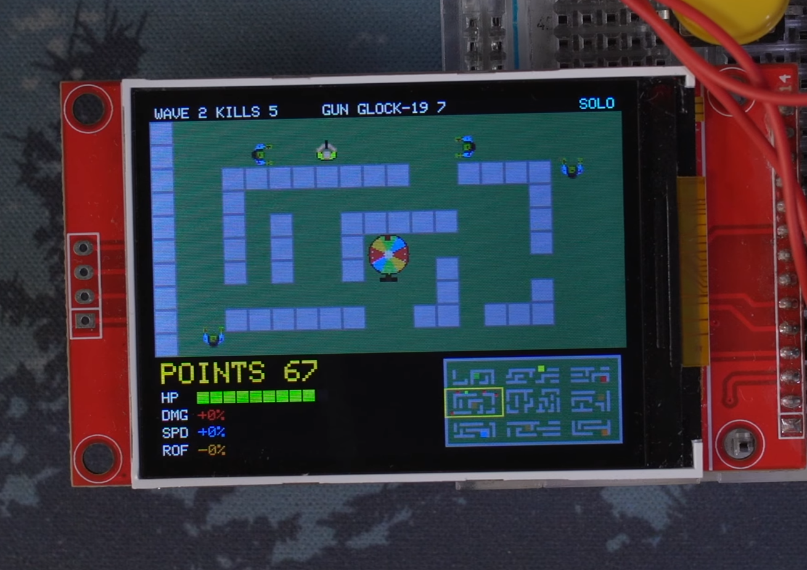

# z32

An ESP32 zombie video game with ESP-NOW multiplayer support. Survive waves, spend kill points at vending machines, and try your luck at the weapon roulette.




## Hardware

Each player needs one set of hardware. For co-op, build two identical sets.

- ESP32
- 2.4-inch ST7789 240 × 320 TFT display (SPI module)
- Analog joystick
- Four buttons: FIRE, RELOAD, INTERACT, and PAUSE
- Passive buzzer
- microSD card (shares the TFT SPI bus)

Pinout: [include/pins.h](include/pins.h)  
Display configuration: [include/tft_setup.h](include/tft_setup.h)

## Installation

Install the [PlatformIO CLI](https://platformio.org/install/cli), the Espressif32 platform, and a USB serial driver.

Dependencies are installed automatically from [platformio.ini](platformio.ini):

- [TFT_eSPI](https://registry.platformio.org/libraries/bodmer/TFT_eSPI)
- [ArduinoJson](https://registry.platformio.org/libraries/bblanchon/ArduinoJson)

```sh
pio run -e host -t upload   # Board 1
pio run -e client -t upload # Board 2, for multiplayer
pio device monitor          # 115200 baud; boot prints "ready role=host/client"
```

> [!IMPORTANT]
> Leave the joystick untouched during boot. It calibrates its centre for about 200 ms; moving it during that time can cause drift for the entire run. Reboot to calibrate again.

## How to play

The kill quota for each wave is the wave number plus 3 (so wave 1 requires 4 kills). Up to 10 zombies can be alive at once; each kill is followed by an instant replacement until the quota is met. After that, there are 3 seconds of quiet before the next wave.

The run ends when no players are left standing. The game saves the run to the scores.

### Controls

|Input|Action|
|:---|:---|
|Joystick|Move; also navigate menus|
|FIRE|Shoot (hold with the MP9 or AR-15); confirm selections|
|INTERACT|Buy upgrades, use the roulette, revive a partner, or call for help when downed|
|RELOAD|Reload a partially used magazine; empty magazines reload automatically|
|PAUSE|Pause the game (Continue / Restart / Exit)|

Shots automatically target the nearest zombie in range: 160 px, or 220 px with the M82A1.

### Shop

Players share a wallet. Stand within 28 px of a machine and press INTERACT to buy an upgrade. Upgrade levels are permanent for each player. Each machine displays its current price above it.

|Machine|Effect|Price|
|:---|:---|:---|
|Heal|+2 HP, up to 10 HP|100 points (fixed price)|
|Damage|+25% damage per level, up to level 10|150 + 300 × level|
|Speed|+8% speed per level, up to level 10|150 + 300 × level|
|Rapid|−6% cooldown per level, up to level 10|150 + 300 × level|

### Roulette

The roulette costs 100 points and awards a random weapon. One of the four pads is active at a time; the active pad rotates every 3 waves, starting at wave 3. New weapons come with a full magazine.

|Weapon|Damage|Fire rate|Magazine|Notes|
|:---|:---|:---|:---|:---|
|Glock-19|1|0.5 s|15|Starter weapon|
|MP9|1|0.18 s|30|Hold FIRE; odds: 30|
|SPAS-12|2 × 3 pellets|0.9 s|8|Spread; 1.5 s reload; odds: 25|
|AR-15|3|0.35 s|30|Hold FIRE; odds: 12|
|FAMAS|1 × 3-round burst|0.6 s|30|One press fires 3 rounds; odds: 13|
|M82A1|6|1.4 s|10|220 px range; 2 s reload; odds: 10|

### Zombies

Zombies path toward the nearest living player and stop at contact range instead of piling up. Players have 0.4 seconds of immunity between hits. There are no runners on wave 1. After that, the number of runners is capped at min(2 × wave / 3, quota / 2), spread evenly across the wave. Every fifth wave, a boss takes spawn slot 0. Zombies always spawn at least 100 px away.

|Type|Color|Speed|HP|Damage|Points awarded|
|:---|:---|:---|:---|:---|:---|
|Normal|Red|40|2 + wave / 2|1|10 + 2 × wave|
|Runner|Orange|80|1 + wave / 4|1|15 + 2 × wave|
|Boss|Purple|30|20 + wave|3|150 + 10 × wave|

### Downed players (multiplayer)

At 0 HP, a player is downed and has 15 seconds of bleed time. Their partner can press INTERACT to revive them with 3 HP. If a player bleeds out, they spectate their partner. The camera, HUD, and panel follow the partner’s weapon and build until the downed player respawns at the start of the next wave.

If a downed player has no machines nearby, pressing INTERACT makes them shout “SAVE ME!”.

## Multiplayer

- The host is authoritative: it simulates both players and broadcasts state at about 30 Hz (146 bytes of state plus 5 bytes of input). The client sends inputs and mirrors the game state.
- There is no pairing process. A fixed custom MAC address (lib/network/Network.h [blocked]) and the build role determine the peer. Flash one board as the host and the other as the client, then select Multi on both.
- The client waits up to 10 seconds to join. If it does not join, the game falls back to Solo; pressing FIRE also triggers the Solo fallback.
- Player 2 shares the wallet and kills and joins with a fresh pistol.
- Either board can request a pause, but the host controls the pause. Game over is mirrored to both boards.

## Screens, scores, and sound

The logo and team screens each display for 2.5 seconds. Press FIRE to skip them.

The scores screen displays runs as {points, kills, wave}. The last four runs are stored in RTC memory, mirrored to /z32_recent.json, and appended to /z32_log.jsonl on the microSD card.

A passive buzzer plays non-blocking jingles for menus, shots, purchases, roulette rolls, damage, waves, reloads, and game over.

## Troubleshooting

- **Waiting never joins**: the other board must also select Multi and be within range. If no peer joins within 10 seconds—or you press FIRE—the game falls back to Solo.
- **Client returns to the menu mid-run**: if the host is silent for 3 seconds, the client may return to the menu. Check the serial monitor for peer quiet 3000ms and move the boards closer together.
- **“no sd, rtc only”**: no microSD card was detected, so runs are stored only in RTC memory. Reseat the card; its CS pin is 22, and it shares the TFT’s SPI bus.
- **“delivery failed” messages**: the peer is out of ESP-NOW range.

## Development and tests

Build either role:

```sh
pio run -e host
pio run -e client
```

Run the hardware-free map and network wire checks:

```sh
./test/native/run.sh
```

A bare pio run builds the host role. The serial console logs events such as saved runs and multiplayer joins.

## License

MIT. See [LICENSE](./LICENSE) for the copyright holders and full terms.
