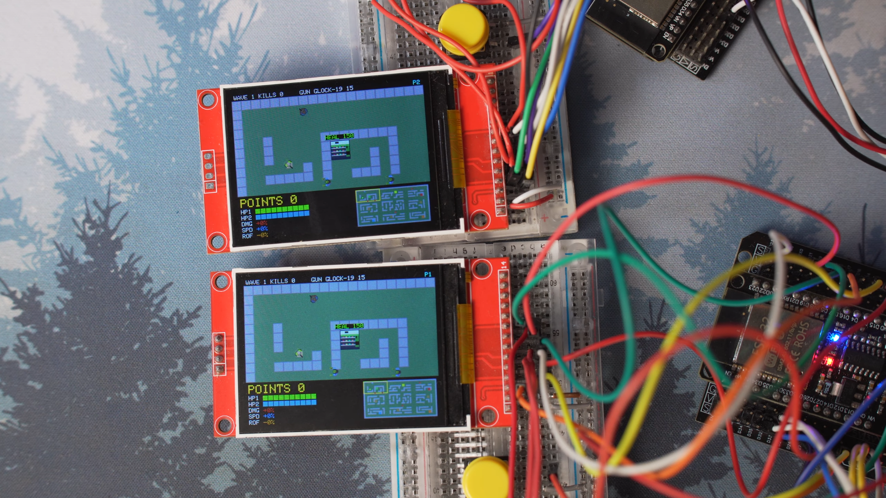

# z32

ESP32 wave-based zombie game with ESP-NOW co-op: survive waves, spend kill points on vending machines and a weapon roulette. Solo on one board, co-op on two.




## Hardware

One set per player (two identical sets for co-op): ESP32 dev board, 2.4" ST7789 240x320 SPI TFT, analog joystick, 4 buttons (FIRE, RELOAD, INTERACT, PAUSE), passive buzzer and microSD (shares the TFT SPI bus). Pinout: [`include/pins.h`](include/pins.h); display config: [`include/tft_setup.h`](include/tft_setup.h).

## Installation

[PlatformIO](https://platformio.org/) with Espressif32 plus a USB serial driver. Library deps ([`TFT_eSPI`](https://registry.platformio.org/libraries/bodmer/TFT_eSPI), [`ArduinoJson`](https://registry.platformio.org/libraries/bblanchon/ArduinoJson)) install automatically from [platformio.ini](platformio.ini).

```sh
pio run -e host -t upload    # board 1
pio run -e client -t upload  # board 2, for multiplayer
pio device monitor           # 115200 baud; boot prints ready role=host/client
```

> [!IMPORTANT]
> Hands off the joystick at boot: the stick calibrates its centre for ~200ms, and any touch then becomes drift for the whole run. Reboot to redo it.

## How to play

**Goal.** `wave + 3` kills (wave 1 = 4), max 10 zombies alive with instant refill, then 3s of quiet before the next wave. You lose when nobody is left standing; the run is saved to scores.

**Controls.**

| Input    | Action                                                        |
| -------- | ------------------------------------------------------------- |
| Joystick | Move (also navigates menus)                                   |
| FIRE     | Shoot (hold with MP9/AR-15) / confirm                         |
| INTERACT | Buy, roll roulette, revive partner, call for help when downed |
| RELOAD   | Top up a half-spent mag (empty mags reload on their own)      |
| PAUSE    | Pause (Continue / Restart / Exit)                             |

Shots auto-target the nearest zombie in range (160px, 220px for the M82A1).

**Shop.** Shared wallet; stand by a machine (28px reach) and press INTERACT. Levels are permanent per player; each machine shows its live price floating above.

| Machine   | Effect                              | Price             |
| --------- | ----------------------------------- | ----------------- |
| H Heal    | +2 HP (up to 10)                    | 100 flat          |
| D Damage  | +25% damage per level, max 10       | 150 + 300 × level |
| S Speed   | +8% speed per level, max 10         | 150 + 300 × level |
| C Rapid   | −6% cooldown per level, max 10      | 150 + 300 × level |

**Roulette (100).** Random weapon; 1 of the 4 pads is active at a time (rotates every 3 waves from wave 3). New guns arrive with a full mag.

| Weapon   | Dmg | Rate | Mag | Notes                        |
| -------- | --- | ---- | --- | ---------------------------- |
| Glock-19 | 1   | 0.5s | 15  | starter                      |
| MP9      | 1   | 0.18s| 30  | hold FIRE (odds 30)          |
| SPAS-12  | 2 × 3 pellets | 0.9s | 8 | spread, 1.5s reload (odds 25) |
| AR-15    | 3   | 0.35s| 30  | hold FIRE (odds 12)          |
| FAMAS    | 1 × 3-round burst | 0.6s | 30 | one press = 3 rounds (odds 13) |
| M82A1    | 6   | 1.4s | 10  | 220px range, 2s reload (odds 10) |

**Zombies.** Path to the nearest living player and stop at contact range instead of piling up; 0.4s immunity between hits taken. No runners on wave 1; afterwards up to `min(2·wave/3, quota/2)`, spread evenly. Every 5th wave a boss takes spawn slot 0. Spawns are always ≥100px away.

| Type   | Color  | Speed | HP            | Dmg | Pays        |
| ------ | ------ | ----- | ------------- | --- | ----------- |
| Normal | red    | 40    | `2 + wave/2`  | 1   | `10 + 2·wave` |
| Runner | orange | 80    | `1 + wave/4`  | 1   | `15 + 2·wave` |
| Boss   | purple | 30    | `20 + wave`   | 3   | `150 + 10·wave` |

**Downed (multiplayer).** At 0 HP you go down for 15s of bleed; your partner presses INTERACT to lift you back at 3 HP. Bleed out and you spectate your partner (camera, HUD and panel follow their gun and build) until you respawn next wave. Downed with no machines near, INTERACT shouts `SAVE ME!`.

## Multiplayer

- Host is authoritative: simulates both players, broadcasts state at ~30Hz (146B state + 5B input); the client sends inputs and mirrors.
- No pairing: a fixed custom MAC ([lib/network/Network.h](lib/network/Network.h)) and the build role pick the peer. Flash one board as `host`, one as `client`, pick Multi on both.
- `waiting` joins or times out after 10s (or FIRE falls back to Solo). P2 shares the wallet/kills and joins with a fresh pistol. Pause can be requested from either board but is owned by the host; game-over mirrors to both.

## Screens, scores & sound

`logo` / `team` show 2.5s each, FIRE skips. Flow: `logo` → `team` → `menu` → `mode` → `scores` / `waiting` → `playing` → `pause` / `game_over`.

The `scores` screen shows runs as `{points, kills, wave}`: last 4 in RTC memory, mirrored to `/z32_recent.json` plus the append-only `/z32_log.jsonl` on microSD. A passive buzzer plays non-blocking jingles for menu, shots, buys, roulette, damage, waves, reloads and game-over.

## Troubleshooting

- **`waiting` never joins**: the other board must also pick Multi, in range. After 10s (or FIRE) you fall back to Solo.
- **Client drops back to menu mid-run**: host quiet for 3s (`peer quiet 3000ms` on serial). Move the boards closer.
- **`no sd, rtc only`**: no microSD detected; runs stay in RTC memory. Reseat the card (CS 22, shared TFT SPI bus).
- **`delivery failed` spam**: the peer is out of ESP-NOW range.

## Development & tests

```sh
pio run -e host | pio run -e client   # build per role (bare pio run = host)
./test/native/run.sh                 # hardware-free map + net wire checks
```

The serial console (115200) logs events only, e.g. run saves and multiplayer joins.

## License

MIT — free to use, modify and distribute. See [LICENSE](LICENSE) for the copyright holders and full terms.
