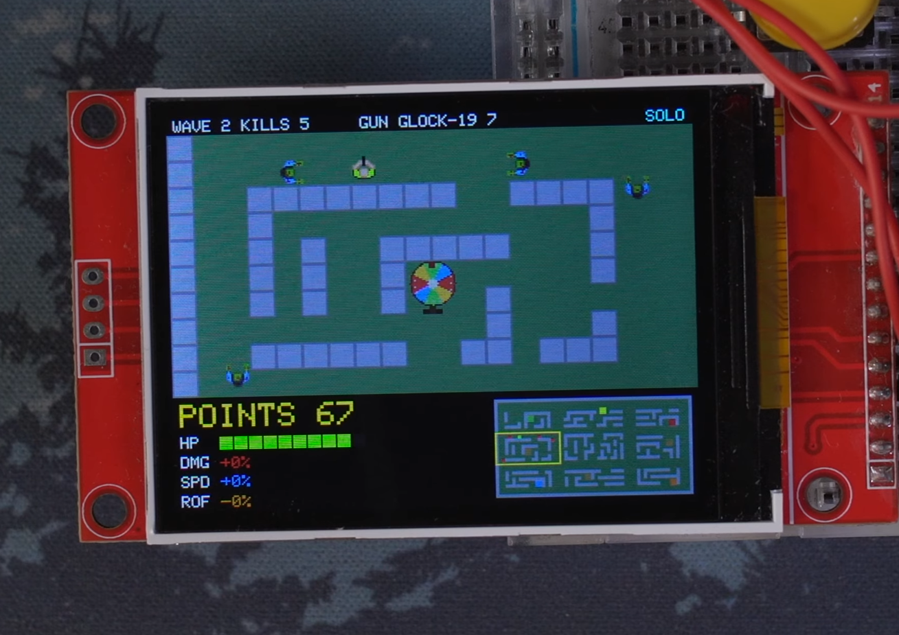
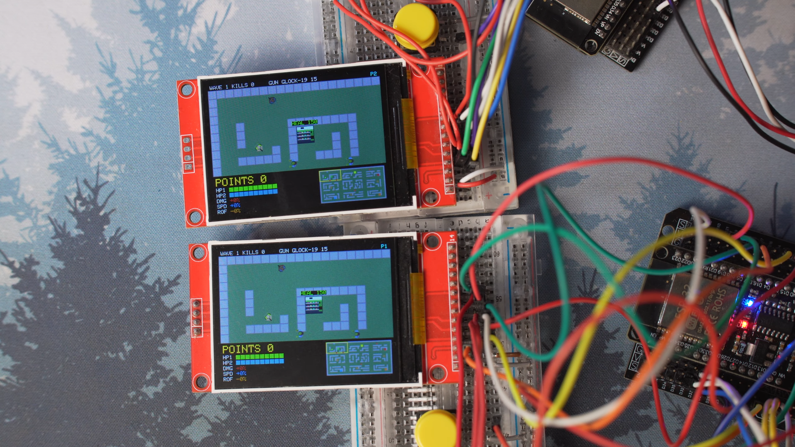
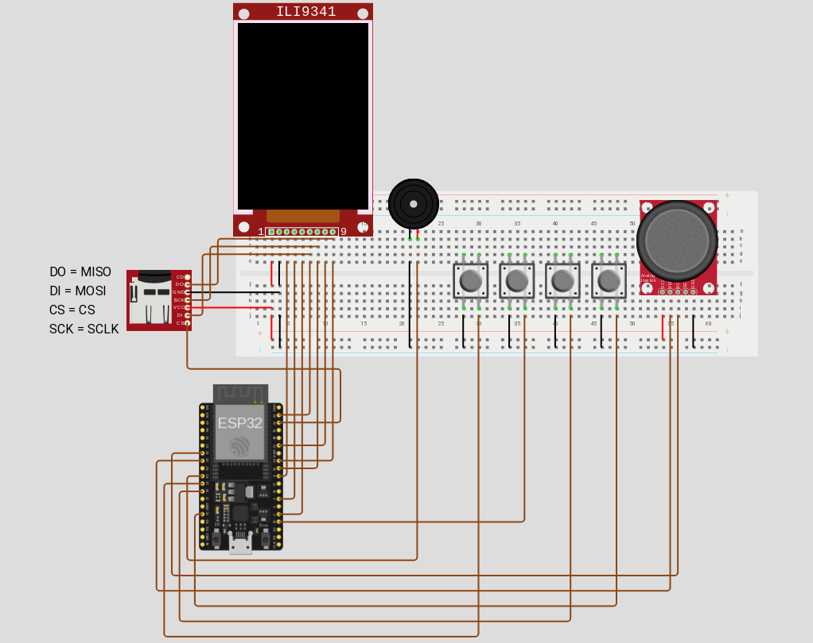

# z32

ESP32 wave-based zombie video game with ESP-NOW multiplayer. Survive endless waves, spend kill points on vending machines and a weapon roulette. Solo on one board, co-op on two.




## Hardware

One set per player (multiplayer needs two identical sets):

- ESP32 dev board
- 2.4" ST7789 240x320 TFT display over SPI
- Analog joystick
- 4 buttons (FIRE, RELOAD, INTERACT, PAUSE)
- Passive buzzer
- MicroSD card (shares the TFT SPI bus)

See [`include/pins.h`](include/pins.h) for the full pinout and [`include/tft_setup.h`](include/tft_setup.h) for the display configuration.



## Installation

You need [PlatformIO](https://platformio.org/) with the Espressif32 platform (see the [install guide](https://docs.platformio.org/en/latest/core/installation/index.html)) plus a USB serial driver for your board. Library deps ([`TFT_eSPI`](https://registry.platformio.org/libraries/bodmer/TFT_eSPI), [`ArduinoJson`](https://registry.platformio.org/libraries/bblanchon/ArduinoJson)) install automatically from [platformio.ini](platformio.ini).

```sh
pio run -e host -t upload    # board 1
pio run -e client -t upload  # board 2, for multiplayer
pio device monitor           # 115200 baud; boot prints ready role=host/client
```

> [!IMPORTANT]
> Hands off the joystick at boot: the stick calibrates its centre for ~200ms, and any touch then becomes drift for the whole run. Reboot to redo it.

## How to play

**Goal.** Each wave asks for `wave + 3` kills (wave 1 = 4), max 10 zombies alive with instant refill, then 3s of quiet before the next wave. You lose when nobody is left standing; the run is saved to scores.

**Controls.**

| Input    | Action                                                        |
| -------- | ------------------------------------------------------------- |
| Joystick | Move (also navigates menus)                                   |
| FIRE     | Shoot (hold with MP9/AR-15) / confirm                         |
| INTERACT | Buy, roll roulette, revive partner, call for help when downed |
| RELOAD   | Top up a half-spent mag (empty mags reload on their own)      |
| PAUSE    | Pause (Continue / Restart / Exit)                             |

Shots auto-target the nearest zombie in range (160px, 220px for the M82A1).

**Shop.** Points are the shared wallet: kill, earn, spend. Stand by a machine (28px reach) and press INTERACT.

| Machine   | Effect                              | Price             |
| --------- | ----------------------------------- | ----------------- |
| H Heal    | +2 HP (up to 10)                    | 100 flat          |
| D Damage  | +25% damage per level, max 10       | 150 + 300 × level |
| S Speed   | +8% speed per level, max 10         | 150 + 300 × level |
| C Rapid   | −6% cooldown per level, max 10      | 150 + 300 × level |

Levels are permanent per player; each machine shows its live price floating above.

**Roulette (100).** Random weapon; only 1 of the 4 pads is active at a time (rotates every 3 waves from wave 3). New guns arrive with a full mag.

| Weapon   | Dmg | Rate | Mag | Notes                        |
| -------- | --- | ---- | --- | ---------------------------- |
| Glock-19 | 1   | 0.5s | 15  | starter                      |
| MP9      | 1   | 0.18s| 30  | hold FIRE (odds 30)          |
| SPAS-12  | 2 × 3 pellets | 0.9s | 8 | spread, 1.5s reload (odds 25) |
| AR-15    | 3   | 0.35s| 30  | hold FIRE (odds 12)          |
| FAMAS    | 1 × 3-round burst | 0.6s | 30 | one press = 3 rounds (odds 13) |
| M82A1    | 6   | 1.4s | 10  | 220px range, 2s reload (odds 10) |

**Zombies.** They path to the nearest living player and stop at contact range instead of piling up. 0.4s immunity between hits taken.

| Type   | Color  | Speed | HP            | Dmg | Pays        |
| ------ | ------ | ----- | ------------- | --- | ----------- |
| Normal | red    | 40    | `2 + wave/2`  | 1   | `10 + 2·wave` |
| Runner | orange | 80    | `1 + wave/4`  | 1   | `15 + 2·wave` |
| Boss   | purple | 30    | `20 + wave`   | 3   | `150 + 10·wave` |

No runners on wave 1; afterwards up to `min(2·wave/3, quota/2)`, spread evenly. Every 5th wave a boss takes spawn slot 0. Spawns are always ≥100px away.

**Downed, spectate & revive (multiplayer).** At 0 HP you go down, not out: 15s of bleed while your partner presses INTERACT to lift you back at 3 HP. Bleed out and you spectate your partner (camera, HUD and panel follow their gun and build) until you respawn next wave. Downed with no machines near, INTERACT shouts `SAVE ME!`.

## Multiplayer

Host is authoritative: it simulates both players and broadcasts state at ~30Hz (146B state + 5B input); the client sends inputs and mirrors. No pairing step: each board carries a fixed custom MAC ([lib/network/src/network.h](lib/network/src/network.h)) and the build role picks the peer — just flash one board as `host`, the other as `client`, and pick Multi on both. They join via `waiting` (10s timeout or FIRE falls back to Solo). P2 shares the wallet/kills and joins with a fresh pistol. Pause can be requested from either board but is owned by the host; game-over mirrors to both.

## Screens, scores & sound

Screen flow (`logo`/`team` show 2.5s each, FIRE skips):

```text
logo - team - menu - mode - scores/waiting - playing - pause / game_over
```

The `scores` screen shows your last runs as `{points, kills, wave}`: last 4 in RTC memory, mirrored to `/z32_recent.json` plus the append-only `/z32_log.jsonl` on microSD.

A passive buzzer plays short non-blocking jingles for menu, shots, buys, roulette, damage, waves, reloads and game-over.

## Troubleshooting

- **Player drifts on its own**: you touched the stick during the ~200ms boot calibration. Reboot hands-off.
- **`waiting` never joins**: the other board must also pick Multi, in range. After 10s (or FIRE) you fall back to Solo.
- **Client drops back to menu mid-run**: host quiet for 3s (`peer quiet 3000ms` on serial). Move the boards closer.
- **`no sd, rtc only`**: no microSD detected; runs are kept in RTC memory only. Reseat the card (CS 22, shared TFT SPI bus).
- **`delivery failed` spam**: the peer is out of ESP-NOW range.

## Development & tests

```sh
pio run -e host | pio run -e client   # build per role (bare pio run = host)
./test/test_native/run.sh             # hardware-free checks (map + net wire)
```

The serial console (115200) logs events only, e.g. run saves and multiplayer joins. `AGENTS.md` is the developer contract (pins, net format, module bounds).

## License

GPL-2.0, see [LICENSE](LICENSE).
